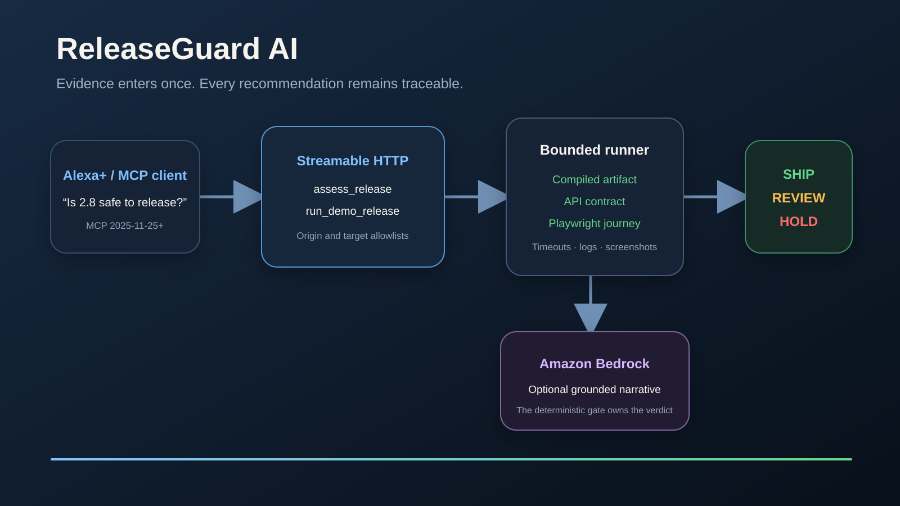

# ReleaseGuard AI

ReleaseGuard AI is an evidence-first release readiness agent for the **Alexa+ primary track** and **AWS Builder mini-challenge** of the 2026 Amazon Build, Ship, Shape Hackathon.

[Watch the redesigned 1:12 demo](docs/demo/releaseguard-redesign-demo.mp4) · [Original 1:52 demo](https://youtu.be/8FaILFxt_Do) · [View the submitted Devpost project](https://devpost.com/software/releaseguard-ai-8gri2d)

Ask: “Is version 2.8 safe to release?” ReleaseGuard runs or accepts concrete build, API, browser, visual, performance, and security evidence; groups related regressions; and returns a defensible `SHIP`, `REVIEW`, or `HOLD` recommendation.



## What works

- Self-hosted MCP server over Streamable HTTP at `/mcp`
- MCP 2025-11-25 compatibility, plus the SDK's 2026 protocol support
- `assess_release` MCP tool with structured evidence and output
- `run_demo_release` MCP tool with a real allowlisted API and Playwright journey
- Deterministic failure clustering and release decision
- Evidence dashboard with a real HOLD-to-SHIP demo
- Optional Amazon Bedrock narrative through the AWS SDK `Converse` API
- Origin validation on the MCP endpoint
- Target allowlisting, browser timeout, console capture, and screenshot evidence

ReleaseGuard deliberately does not expose arbitrary shell execution through MCP. New repositories and CI providers are added as reviewed project adapters.

## Run locally

Requirements: Node.js 20 or newer and Google Chrome installed locally. The demo uses
`playwright-core` with the Chrome channel, so installing npm dependencies does not
install a browser.

```bash
npm install
npm run build
npm start
```

Open `http://127.0.0.1:3210`.

1. Select candidate **2.8.0-rc.1** and choose **Check release**. The web client connects automatically, acknowledges initialization, discovers the tools, and calls `run_demo_release` through MCP. A real API check receives HTTP 500, Playwright finds the checkout button disabled, and ReleaseGuard returns `HOLD`.
2. Select candidate **2.8.0-rc.2** and choose **Check release** again. The API returns HTTP 201, the browser completes checkout, and ReleaseGuard returns `SHIP`.
3. Inspect the evidence table, then expand **Related findings**, **Browser capture**, or **Protocol activity** for more detail.

These are seeded local checkout candidates. The live tool verifies the compiled artifact's presence and runs real API, browser, and duration checks. It does not run a project's full CI suite or publish a release. Each run captures a fresh screenshot; transport errors clear the preceding verdict instead of leaving stale success visible. Bedrock is disabled by the web client.

MCP endpoint: `http://127.0.0.1:3210/mcp`

The server exposes:

- `assess_release` — assess structured evidence from CI or another agent.
- `run_demo_release` — run the included, bounded release-candidate demo.

## Optional Bedrock integration

ReleaseGuard's verdict is deterministic and never delegated to a model. When enabled, Amazon Bedrock adds a concise narrative grounded in the generated report.

1. Copy `.env.example` values into your environment.
2. Configure AWS credentials through the normal AWS credential chain.
3. Set `RELEASEGUARD_USE_BEDROCK=1` and a model available to your account.

The runtime integration is implemented in `src/bedrock.ts` with `BedrockRuntimeClient` and `ConverseCommand`.

## Verify

```bash
npm run check
npm start
# in another terminal
npm run smoke:mcp
npm run verify:demo
npm run verify:browser
```

`verify:demo` uses the actual MCP SDK client to run both checkout candidates and
requires RC.1 `HOLD` followed by RC.2 `SHIP`. `verify:browser` checks the dashboard's
actual MCP requests, keyboard operation, light and dark layouts, and narrow screens.
It also verifies that an injected transport error clears a previous success;
that negative test is never part of the recording.

For a continuous browser recording, install Playwright's free FFmpeg helper with
`node node_modules/playwright-core/cli.js install ffmpeg`, then run
`npm run record:demo` while the server is running. The recording uses installed
Chrome, sends real MCP calls, and includes the resulting checkout screenshots.
No responses are intercepted or mocked during recording. Set
`RELEASEGUARD_EVIDENCE_DIR` to a fresh directory for each verification or recording;
the script refuses to overwrite an earlier run. `RELEASEGUARD_MCP_URL` and
`RELEASEGUARD_DEMO_URL` can select another localhost port. Keep
`RELEASEGUARD_USE_BEDROCK=0` for this demo.

## Safety model

- Decisions cite only checks supplied to the assessment.
- No arbitrary commands, repository writes, deployment actions, or release actions are exposed.
- Browser/build execution uses named project adapters and explicit budgets.
- A `SHIP` recommendation is advisory; ReleaseGuard does not publish a release.

## Hackathon requirements tracked

- Primary: Alexa+ — self-hosted MCP server, MCP 2025-11-25+, Streamable HTTP
- Mini-challenge: AWS Builder — documented Amazon Bedrock runtime integration
- Apache-2.0 open-source license
- Architecture diagram and verified screenshots in `docs/`
- Product feedback and friction log in `docs/`

## License

Apache-2.0. See `LICENSE`.
